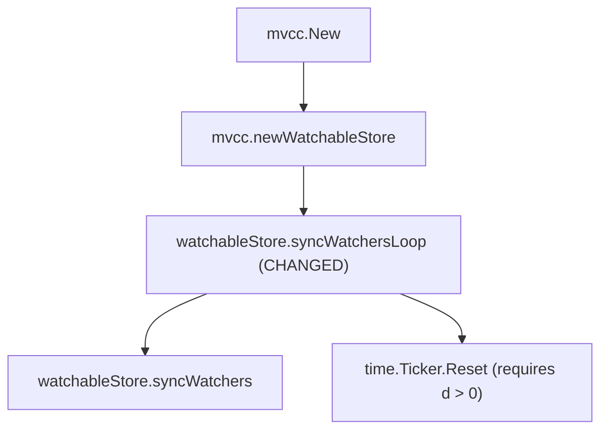

# PR verification: etcd-io/etcd#22269

- **Title**: ``mvcc: Deflake `TestWatchVictims` with `synctime` ``
- **URL**: <https://github.com/etcd-io/etcd/pull/22269>
- **Author**: `Hrishi-Baskaran`
- **Fixes**: <https://github.com/etcd-io/etcd/issues/22266> (and addresses the `Ticker.Reset(0)` panic in <https://github.com/etcd-io/etcd/issues/22296> / `issues/etcd-watch-sync-ticker-reset-zero.md`)
- **PR head**: `4d6a3b013433b5d522e83a180b84b9226d88fd44`
- **Upstream base**: `77ba2eb47c7fa01cf63bc1e0e43ff1ce59b02be3`
- **Goose fork branch**: `pr-etcd-22269-goose-lean` (`e0d3628f1b3d977e0b47ae1fd17c221ab65528d5`, onto `bc9c3868ced67e518fb2fecba44ce0fa70b7303b`)
- **Proof branch**: `pr-verify/etcd-22269`
- **Tests and logs**: `notes/pr-verify/etcd-22269/` (`notes/pr-verify/etcd-22269/README.md`)
- **Verdict**: **Verified (provably eliminates the `Ticker.Reset` non-positive duration panic via clamping to `time.Nanosecond`)**

| Function | Go file | Kind | Coverage before | Coverage after | Outcome |
|---|---|---|---|---|---|
| `watchableStore.syncWatchersLoop` | `server/storage/mvcc/watchable_store.go` | Behavior change | Verified (sorry-free) | Verified (sorry-free) | Old spec (`watchableStore__syncWatchersLoop.lean`) re-proved directly over the `time.Nanosecond` clamp and two `delayTicker.Reset` calls |
| `mvcc.New` / `mvcc.newWatchableStore` | `server/storage/mvcc/watchable_store.go` | Caller | Verified (sorry-free) | Verified (sorry-free) | Unchanged spec and proof |

---

## 1. What the PR Changes

In `server/storage/mvcc/watchable_store.go`, `watchableStore.syncWatchersLoop` measures `syncDuration := time.Since(st)` around `s.syncWatchers()` and, when more work is pending (`unsyncedWatchers != 0 && lastUnsyncedWatchers > unsyncedWatchers`), resets `delayTicker` to `syncDuration`. Because `time.Ticker.Reset(d)` panics if `d <= 0` (`issues/etcd-watch-sync-ticker-reset-zero.md`) and `time.Since(st)` returns `0` in a `testing/synctest` bubble (or on a coarse monotonic clock such as Windows), `etcd-io/etcd#22269` clamps `syncDuration` to at least `time.Nanosecond`:

```go
		// set to at least a nonzero value to avoid panics when
		// testing with synctest
		syncDuration := max(time.Since(st), time.Nanosecond)

		delayTicker.Reset(watchResyncPeriod)
		// more work pending?
		if unsyncedWatchers != 0 && lastUnsyncedWatchers > unsyncedWatchers {
			// be fair to other store operations by yielding time taken
			delayTicker.Reset(syncDuration)
		}
```

### Goose Adaptation

1. `goose-lean` (`bc9c3868ced67e518fb2fecba44ce0fa70b7303b`) previously cherry-picked `etcd-io/etcd#22297` (`5615016f6a4d70e9d191bf9577650f9050c182c1`), which replaced the two `delayTicker.Reset` calls in `syncWatchersLoop` with `delayTicker.Reset(resyncDelay(syncDuration, lastUnsyncedWatchers, unsyncedWatchers))`. To verify `etcd-io/etcd#22269`'s actual `syncWatchersLoop` implementation, `syncWatchersLoop` on `pr-etcd-22269-goose-lean` restores the upstream two-`Reset` structure with `#22269`'s `syncDuration` clamp.
2. Goose does not yet translate Go 1.21's builtin `max(a, b)`, so `syncDuration := max(time.Since(st), time.Nanosecond)` is written in equivalent form:
   ```go
   syncDuration := time.Since(st)
   if syncDuration < time.Nanosecond {
   	syncDuration = time.Nanosecond
   }
   ```

---

## 2. Specification Comparison

### `mvcc.watchableStore.syncWatchersLoop` (`Spec/go_etcd_io/etcd/server/v3/storage/mvcc/watchableStore__syncWatchersLoop.lean`)

The specification is unchanged:

```lean
abbrev mvcc.watchableStore.syncWatchersLoop.spec : Prop :=
  ∀ (s st : Loc) (γ : mvcc.WsNames),
  {{ isPkgInit (PROP := IProp GF) pkg_id.go_etcd_io.etcd.server.v3.storage.mvcc ∗
      mvcc.isWatchableStore s st γ ∗ mvcc.watchReader s st γ ∗ mvcc.wsDone s }}
    (App (Val (s @!! go.GoType.PointerType watchableStore.ty @!! go!"syncWatchersLoop")) (Val #()))
  {{ RET #(); True }}
```

In `Proof/go_etcd_io/etcd/server/v3/storage/mvcc/watchableStore__syncWatchersLoop.lean`, after `time.wp_Since` returns an arbitrary `d : w64`, joining the `if syncDuration < time.Nanosecond` branch establishes `∃ d' : w64, syncDuration_ptr ↦ d' ∗ ⌜0 < sint.Z d'⌝` (since `time.Nanosecond = W64 1 > 0` in the `then` branch and `¬ (sint.Z d < 1)` in the `else` branch). This discharges the `0 < sint.Z d'` precondition of `time.Ticker.Reset.spec` in the `unsyncedWatchers != 0 && lastUnsyncedWatchers > unsyncedWatchers` branch without any clock-positivity axiom.

---

## 3. Callers and Impact



---

## 4. Trust Base (`etc/tcb-collections/pr-etcd-22269.txt`)

- **New axioms introduced**: `0`
- **New `sorry`s introduced**: `0`
- `mvcc.watchableStore.syncWatchersLoop.wp_proof` is verified and sorry-free.

---

## 5. Findings

1. **Formal proof that `etcd-io/etcd#22269`'s clamp prevents the `Ticker.Reset` panic (`issues/etcd-watch-sync-ticker-reset-zero.md`)**:
   Without clamping `syncDuration` (or `resyncDelay`), `TestWatchVictims` in `testing/synctest` panics immediately (`panic: non-positive interval for Ticker.Reset` at `watchable_store.go:248`, `notes/pr-verify/etcd-22269/watch_victims_unclamped.log`), because `time.Now()` does not advance during `s.syncWatchers()` in a `synctest` bubble. Clamping `syncDuration` to at least `time.Nanosecond` guarantees `0 < sint.Z syncDuration`, discharging `time.Ticker.Reset`'s precondition in `watchableStore.syncWatchersLoop.wp_proof` and making `TestWatchVictims` pass in `0.04s` (`notes/pr-verify/etcd-22269/watch_victims_head.log`).
2. **Comparison with `etcd-io/etcd#22297` (`resyncDelay`)**:
   - In `etcd-io/etcd#22269`, when `time.Since(st) <= 0` and more unsynced watchers remain (`unsyncedWatchers != 0 && lastUnsyncedWatchers > unsyncedWatchers`), `delayTicker` is first reset to `watchResyncPeriod` (`100ms`) and immediately reset again to `1ns` (`time.Nanosecond`). In `synctest`, this yields `1ns` of simulated time per sync batch (`100ms` total simulated time in `watch_victims_head.log`), whereas on a real system with a coarse monotonic clock (e.g., Windows `0.5–15.6ms` tick) it re-runs `syncWatchers()` after `1ns` instead of yielding.
   - In `etcd-io/etcd#22297` (`resyncDelay`), `delayTicker.Reset` is called only once per iteration, and when `syncDuration <= 0` it falls back to `watchResyncPeriod` (`100ms`), which also passes `TestWatchVictims` in `synctest` (`0.05s` wall time, `12.8s` simulated time in `watch_victims_resyncdelay.log`).
