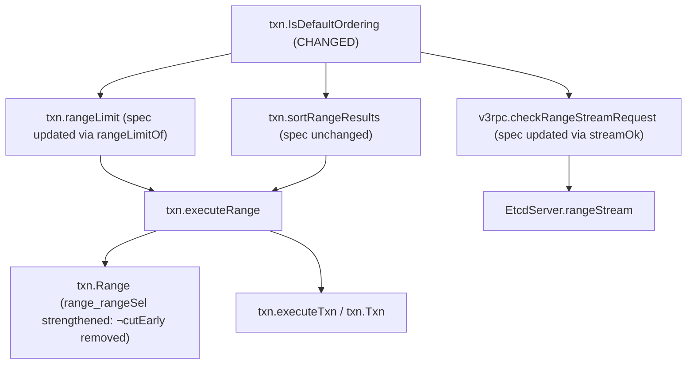

# PR verification: etcd-io/etcd#22615

- **Title**: `etcdserver: fix range limit with non-key sort target and sort order NONE`
- **URL**: <https://github.com/etcd-io/etcd/pull/22615>
- **Author**: `ShivanshhhG`
- **Fixes**: <https://github.com/etcd-io/etcd/issues/22612> (`issues/etcd-range-sort-none-limit.md`)
- **PR head**: `017cb18c344bcaf006518682362a479a81185699`
- **Upstream base**: `22cc5d9acd4a5953dfdfc2594dbeb53da89bb0d4`
- **Goose fork branch**: `pr-etcd-22615-goose-lean` (`3502de21b9751cd60bc916260ffbe397ce92481e`, onto `bc9c3868ced67e518fb2fecba44ce0fa70b7303b`)
- **Proof branch**: `pr-verify/etcd-22615`
- **Tests and logs**: `notes/pr-verify/etcd-22615/` (`notes/pr-verify/etcd-22615/README.md`)
- **Verdict**: **Verified (fixes #22612 and #22615's target bug; exposes an unupdated integration test in `TestV3RangeRequest/sort` via `v3rpc.checkRangeStreamRequest`)**

| Function | Go file | Coverage before | Spec changed? | Proof updated? | Notes |
|---|---|---|---|---|---|
| `txn.IsDefaultOrdering` | `server/etcdserver/txn/range.go` | Verified (sorry-free) | Yes (`IsDefaultOrdering.lean`) | Yes (`IsDefaultOrdering.lean`) | Requires `sortTarget == KEY` in addition to `sortOrder == NONE \|\| sortOrder == ASCEND` |
| `txn.rangeLimit` | `server/etcdserver/txn/range.go` | Verified (sorry-free) | Yes (via `txn.isDefaultOrd` in `txn.rangeLimitOf`) | Yes (`rangeLimit.lean`) | Returns `0` (no mvcc limit) when `sortTarget != KEY && sortOrder == NONE` |
| `txn.sortRangeResults` | `server/etcdserver/txn/range.go` | Verified (sorry-free) | No (`txn.srvSorted` unchanged) | Yes (`sortRangeResults.lean`) | Adjusts `(sortTarget != KEY && sortOrder == NONE)` to `ASCEND` before calling `IsDefaultOrdering`, so its behavior and spec are invariant |
| `txn.executeRange` / `txn.Range` | `server/etcdserver/txn/range.go` | Verified (sorry-free) | Strengthened (`range_rangeSel` drops `¬ cutEarly o`) | Yes (`RangeModel.lean`, `RangeLemmas.lean`, `Results.lean`) | `not_cutEarly : ∀ o, ¬ cutEarly o` proved unconditionally |
| `v3rpc.checkRangeStreamRequest` | `server/etcdserver/api/v3rpc/key.go` | Verified (sorry-free) | Yes (via `v3rpc.streamOk` in `InvKV.lean`) | Yes (`checkRangeStreamRequest.lean`) | Rejects `sortTarget != KEY && sortOrder == NONE` with `codes.Unimplemented` (fixes `issues/etcd-rangestream-sort-none.md`, breaks `TestV3RangeRequest/sort` case 5 unless test expectation is updated) |

---

## 1. What the PR Changes

In `server/etcdserver/txn/range.go`, `IsDefaultOrdering` decides whether a `RangeRequest`'s sort order matches `mvcc.Range`'s native key-ascending order:

```go
// Before:
func IsDefaultOrdering(sortTarget pb.RangeRequest_SortTarget, sortOrder pb.RangeRequest_SortOrder) bool {
	return sortOrder == pb.RangeRequest_NONE ||
		(sortTarget == pb.RangeRequest_KEY && sortOrder == pb.RangeRequest_ASCEND)
}

// After (etcd-io/etcd#22615):
func IsDefaultOrdering(sortTarget pb.RangeRequest_SortTarget, sortOrder pb.RangeRequest_SortOrder) bool {
	return sortTarget == pb.RangeRequest_KEY &&
		(sortOrder == pb.RangeRequest_NONE || sortOrder == pb.RangeRequest_ASCEND)
}
```

When a `RangeRequest` specifies a non-key `SortTarget` (`VERSION`, `CREATE`, `MOD`, or `VALUE`) with `SortOrder: NONE`, `sortRangeResults` (`server/etcdserver/txn/range.go:126-131`) normalizes `sortOrder` to `ASCEND` and sorts the results by `SortTarget`. Before this PR, `IsDefaultOrdering(r.SortTarget, r.SortOrder)` returned `true` whenever `r.SortOrder == NONE` regardless of `r.SortTarget`. Consequently, `rangeLimit(r)` (`server/etcdserver/txn/range.go:88-94`) passed `r.Limit + 1` to `txnRead.Range`, truncating the range to the first `r.Limit + 1` keys in lexicographical key order *before* `sortRangeResults` sorted them by `r.SortTarget` (`etcd-io/etcd#22612`, `issues/etcd-range-sort-none-limit.md`).

With the PR, `IsDefaultOrdering` returns `true` if and only if `sortTarget == KEY && (sortOrder == NONE || sortOrder == ASCEND)`.

---

## 2. Specification Comparison

### `txn.IsDefaultOrdering` (`Spec/go_etcd_io/etcd/server/v3/etcdserver/txn/IsDefaultOrdering.lean`)

```lean
-- Before:
abbrev txn.IsDefaultOrdering.spec : Prop :=
  ∀ (target order : w32),
  {{ isPkgInit (PROP := IProp GF) pkg_id.go_etcd_io.etcd.server.v3.etcdserver.txn }}
    (App (App (Val (@! txn.IsDefaultOrdering)) (Val #target)) (Val #order))
  {{ RET #(decide (order = W32 0 ∨ (target = W32 0 ∧ order = W32 1))); True }}

-- After:
abbrev txn.IsDefaultOrdering.spec : Prop :=
  ∀ (target order : w32),
  {{ isPkgInit (PROP := IProp GF) pkg_id.go_etcd_io.etcd.server.v3.etcdserver.txn }}
    (App (App (Val (@! txn.IsDefaultOrdering)) (Val #target)) (Val #order))
  {{ RET #(decide (target = W32 0 ∧ (order = W32 0 ∨ order = W32 1))); True }}
```

### Pure range model (`Proof/go_etcd_io/etcd/server/v3/etcdserver/txn/RangeModel.lean`)

In `RangeModel.lean`, `isDefaultOrd` models `IsDefaultOrdering` on sign-extended 64-bit fields of `OpFull`:

```lean
-- Before:
def isDefaultOrd (target order : w64) : Bool :=
  decide (order = W64 0 ∨ (target = W64 0 ∧ order = W64 1))

-- After:
def isDefaultOrd (target order : w64) : Bool :=
  decide (target = W64 0 ∧ (order = W64 0 ∨ order = W64 1))
```

Previously, the bridge theorem `srvRangeOk_rangeKvsOk` (connecting the server's `executeRange` output `srvRangeOk` to the client model's `rangeKvsOk o (rangeSel s o)`) required the hypothesis `¬ cutEarly o`, where:

```lean
def cutEarly (o : OpFull) : Prop :=
  (o.effSortOrder = W64 1 ∨ o.effSortOrder = W64 2) ∧ 0 < sint.Z (rangeLimitOf o)
```

With the updated `isDefaultOrd`, `0 < sint.Z (rangeLimitOf o)` implies `isDefaultOrd o.sortTarget o.sortOrder = true`, which gives `o.sortTarget = W64 0 ∧ (o.sortOrder = W64 0 ∨ o.sortOrder = W64 1)`, and therefore `o.effSortOrder = W64 0` for every `o : OpFull`. Thus `¬ cutEarly o` is now an unconditional theorem:

```lean
theorem not_cutEarly (o : OpFull) : ¬ cutEarly o
```

As a result:
- `txn.range_rangeSel` (`Proof/go_etcd_io/etcd/server/v3/etcdserver/txn/Results.lean:208-223`) drops `¬ cutEarly o` from its precondition.
- `client.wire_not_cutEarly` (`Proof/go_etcd_io/etcd/client/v3/ServerKVGet.lean:108-109`) collapses from a 27-line case analysis to `txn.not_cutEarly (rangeWireOf o)`.

### `v3rpc.checkRangeStreamRequest` (`Proof/go_etcd_io/etcd/server/v3/etcdserver/api/v3rpc/InvKV.lean`)

`v3rpc.checkRangeStreamRequest` (`server/etcdserver/api/v3rpc/key.go:169-179`) calls `txn.IsDefaultOrdering(r.SortTarget, r.SortOrder)` directly and returns `status.Errorf(codes.Unimplemented, "RangeStream does not support custom sort orders")` when it is `false`. Its spec (`Spec/go_etcd_io/etcd/server/v3/etcdserver/api/v3rpc/checkRangeStreamRequest.lean`) states `err = GoInterface.nil ↔ v3rpc.streamOk o` when `rangeCheck o = none`. Updating the proof required updating `v3rpc.streamOk`:

```lean
-- Before:
def streamOk (o : OpFull) : Prop :=
  (o.sortOrder = W64 0 ∨ (o.sortTarget = W64 0 ∧ o.sortOrder = W64 1)) ∧
    txn.hasRevFilters o = false

-- After:
def streamOk (o : OpFull) : Prop :=
  (o.sortTarget = W64 0 ∧ (o.sortOrder = W64 0 ∨ o.sortOrder = W64 1)) ∧
    txn.hasRevFilters o = false
```

---

## 3. Callers and Impact



1. **`txn.rangeLimit`** (`server/etcdserver/txn/range.go:88`): Calls `IsDefaultOrdering(r.SortTarget, r.SortOrder)`. For `r.SortTarget != KEY && r.SortOrder == NONE`, `rangeLimit(r)` now returns `0` so `txnRead.Range` reads all keys in `[key, end)` before `sortRangeResults` sorts and `executeRange` truncates to `r.Limit`.
2. **`txn.sortRangeResults`** (`server/etcdserver/txn/range.go:126-131`): Rewrites `if r.SortTarget != pb.RangeRequest_KEY && sortOrder == pb.RangeRequest_NONE { sortOrder = pb.RangeRequest_ASCEND }` *before* calling `IsDefaultOrdering(r.SortTarget, sortOrder)`. For the adjusted `sortOrder`, `sortOrder == NONE || (sortTarget == KEY && sortOrder == ASCEND)` is equivalent to `sortTarget == KEY && (sortOrder == NONE || sortOrder == ASCEND)` (`txn.effSortOrder_srv` in `Proof/go_etcd_io/etcd/server/v3/etcdserver/txn/sortRangeResults.lean:181-191`). Thus `sortRangeResults`'s behavior and specification (`txn.srvSorted`) are completely unchanged.
3. **`v3rpc.checkRangeStreamRequest`** (`server/etcdserver/api/v3rpc/key.go:173`): Calls `!txn.IsDefaultOrdering(r.SortTarget, r.SortOrder)` on the raw request. See Finding 2 below.

---

## 4. Trust Base (`etc/tcb-collections/pr-etcd-22615.txt`)

- **New axioms introduced**: `0`
- **New `sorry`s introduced**: `0`
- `etc/tcb-report.py --collection etc/tcb-collections/pr-etcd-22615.txt --check`:
  `8 of 3183 roots match ... 8 of them reach no sorry. This repository's axioms they rest on: 16 ... Unfinished proofs (sorry) they reach: 0 (none)`.
- `txn.IsDefaultOrdering.wp_proof`, `txn.rangeLimit.wp_proof`, `txn.sortRangeResults.wp_proof`, `txn.executeRange.wp_proof`, `txn.Range.wp_proof`, `txn.range_rangeSel`, `txn.srvRangeOk_rangeKvsOk`, `txn.not_cutEarly`, and `v3rpc.checkRangeStreamRequest.wp_proof` are all verified and sorry-free (`etc/verified-code.py --functions --package go.etcd.io/etcd/server/v3/etcdserver/txn --package go.etcd.io/etcd/server/v3/etcdserver/api/v3rpc`).
- All 7,523 default build targets in `lake build` build cleanly with zero regressions.

---

## 5. Findings

### Finding 1: Formal proof that `etcd-io/etcd#22615` fixes `etcd-io/etcd#22612` (`issues/etcd-range-sort-none-limit.md`)

Our formalization of `txn.Range` previously carried the explicit exception `cutEarly o` (`Proof/go_etcd_io/etcd/server/v3/etcdserver/txn/RangeModel.lean:147-148`) in `srvRangeOk_rangeKvsOk` and `range_rangeSel`, corresponding to `issues/etcd-range-sort-none-limit.md` (`etcd-io/etcd#22612`). With PR #22615's definition of `IsDefaultOrdering`, we proved `not_cutEarly : ∀ o : OpFull, ¬ cutEarly o` with no hypotheses (`RangeModel.lean:595-601`), eliminating the `¬ cutEarly o` assumption from `range_rangeSel`.

The PR's unit test `TestRangeSortLimit` (`notes/pr-verify/etcd-22615/range_sort_limit_test.go`) fails on the base revision on `limit_1` (`expected: []string{"c"}`, `actual: []string{"b"}`, `notes/pr-verify/etcd-22615/range_sort_limit_base.log`) and passes on the PR (`notes/pr-verify/etcd-22615/range_sort_limit_head.log`). (Note: in `TestRangeSortLimit`, `limit_2` passes even on the base revision because there are 3 keys `"a"`, `"b"`, `"c"` and `rangeLimit` fetches `limit + 1 = 3` keys.)

### Finding 2: `v3rpc.checkRangeStreamRequest` now rejects `SortTarget != KEY` with `SortOrder == NONE` (fixes `issues/etcd-rangestream-sort-none.md`, but breaks `TestV3RangeRequest/sort` unless updated)

Updating `v3rpc.checkRangeStreamRequest.wp_proof` required changing `v3rpc.streamOk` (`Proof/go_etcd_io/etcd/server/v3/etcdserver/api/v3rpc/InvKV.lean:72-74`). Because `checkRangeStreamRequest` (`server/etcdserver/api/v3rpc/key.go:173`) checks:

```go
if !txn.IsDefaultOrdering(r.SortTarget, r.SortOrder) {
	return status.Errorf(codes.Unimplemented, "RangeStream does not support custom sort orders")
}
```

changing `txn.IsDefaultOrdering` changes `RangeStream`'s admission check:
- **Positive effect (fixes `issues/etcd-rangestream-sort-none.md`)**: Previously, `checkRangeStreamRequest` accepted requests with `SortTarget != KEY` and `SortOrder == NONE` (`notes/pr-verify/etcd-22615/rangestream_sort_none_base.log`). `EtcdServer.rangeStream` (`server/etcdserver/v3_server.go:180-258`) then streamed results in chunks using `Limit: maxKeysPerChunk`, sorting only within each chunk and advancing `lastKey` to the last key after in-chunk sorting, which returned unsorted results across chunks and skipped keys on multi-chunk streams. Rejecting `SortTarget != KEY && SortOrder == NONE` with `codes.Unimplemented` (`notes/pr-verify/etcd-22615/rangestream_sort_none_head.log`) prevents `RangeStream` from silently returning wrong results.
- **Test breakage (`TestV3RangeRequest/sort` in `tests/integration/v3_grpc_test.go`)**: In `tests/integration/v3_grpc_test.go:1424-1477`, `TestV3RangeRequest/sort` runs every sort request in `reqs` through both `Range` and `RangeStream`. Test case `reqs[5]` (`{Key: []byte("a"), RangeEnd: []byte("z"), Limit: 10, SortOrder: pb.RangeRequest_NONE, SortTarget: pb.RangeRequest_CREATE}`, lines 1457–1462) is listed in `streamUnsupported` as `5: false` (line 1476: `// Only ASCEND+KEY (index 0) and SortOrder_NONE (index 5) are supported by RangeStream`). With PR #22615, `TestV3RangeRequest/sort` fails at `v3_grpc_test.go:1566` (`rangeStream` at line 1609):
  ```
  v3_grpc_test.go:1566:
      Error Trace: .../tests/integration/v3_grpc_test.go:1609
                   .../tests/integration/v3_grpc_test.go:1566
      Error:       Received unexpected error:
                   rpc error: code = Unimplemented desc = RangeStream does not support custom sort orders
      Test:        TestV3RangeRequest/sort
  ```
  (Full log in `notes/pr-verify/etcd-22615/v3_grpc_sort_head.log`; see also `rangeStreamSupports` in `tests/common/kv_test.go:301`.) Removing `5: false` from `streamUnsupported` in `tests/integration/v3_grpc_test.go:1476-1477` aligns the integration test with the new `IsDefaultOrdering` behavior.

---

## 6. Draft Review Comment

```markdown
The change to `txn.IsDefaultOrdering` also affects `v3rpc.checkRangeStreamRequest` (`server/etcdserver/api/v3rpc/key.go:173`), which calls `!txn.IsDefaultOrdering(r.SortTarget, r.SortOrder)` and returns `codes.Unimplemented` ("RangeStream does not support custom sort orders").

Rejecting `SortTarget != KEY` with `SortOrder == NONE` in `checkRangeStreamRequest` makes sense because `RangeStream` paginates by key range and cannot sort across chunks by a non-key target. However, `TestV3RangeRequest/sort` in `tests/integration/v3_grpc_test.go:1457-1477` currently expects `reqs[5]` (`SortOrder: pb.RangeRequest_NONE, SortTarget: pb.RangeRequest_CREATE`) to succeed on `RangeStream`:

```go
	// Only ASCEND+KEY (index 0) and SortOrder_NONE (index 5) are supported by RangeStream
	streamUnsupported := map[int]bool{0: false, 5: false}
```

With this change, `go test -run '^TestV3RangeRequest/sort$' ./integration/` in `tests/` fails at `v3_grpc_test.go:1566` (`rpc error: code = Unimplemented desc = RangeStream does not support custom sort orders`). Updating `streamUnsupported` in `tests/integration/v3_grpc_test.go:1476-1477` (removing `5: false`) and `rangeStreamSupports` in `tests/common/kv_test.go:301` should make the integration and e2e tests pass.
```
