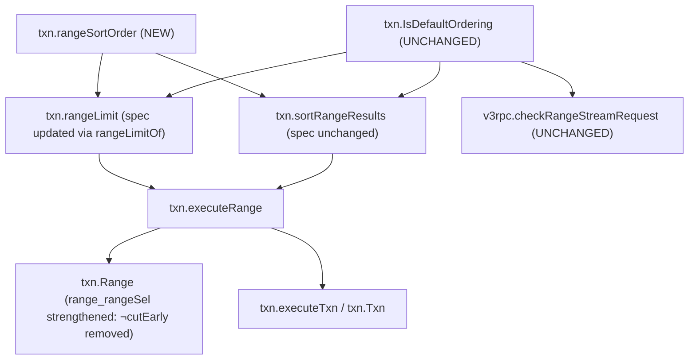

# PR verification: etcd-io/etcd#22616

- **Title**: `etcdserver: read the whole range before sorting with SortOrder NONE`
- **URL**: <https://github.com/etcd-io/etcd/pull/22616>
- **Author**: `upamanyus`
- **Fixes**: <https://github.com/etcd-io/etcd/issues/22612> (`issues/etcd-range-sort-none-limit.md`)
- **PR head**: `6cb3f6108d7598a675ad4e70251171f268c1c6a1`
- **Upstream base**: `22cc5d9acd4a5953dfdfc2594dbeb53da89bb0d4`
- **Goose fork branch**: `pr-etcd-22616-goose-lean` (`6be819cfe8d3a246d8b9869498d9095f2819e0ef`, onto `bc9c3868ced67e518fb2fecba44ce0fa70b7303b`)
- **Proof branch**: `pr-verify/etcd-22616`
- **Tests and logs**: `notes/pr-verify/etcd-22616/` (`notes/pr-verify/etcd-22616/README.md`)
- **Verdict**: **Verified (fixes #22612 cleanly without altering `txn.IsDefaultOrdering` or `v3rpc.checkRangeStreamRequest`)**

| Function | Go file | Kind | Coverage before | Coverage after | Outcome |
|---|---|---|---|---|---|
| `txn.rangeSortOrder` | `server/etcdserver/txn/range.go` | New | Not present | Verified (sorry-free) | New spec (`rangeSortOrder.lean`) proved over `txn.rangeSortOrderOf` |
| `txn.rangeLimit` | `server/etcdserver/txn/range.go` | Behavior change | Verified (sorry-free) | Verified (sorry-free) | Spec updated via `txn.rangeLimitOf` (`isDefaultOrd o.sortTarget (rangeSortOrderOf o)`); returns `0` when `sortTarget != KEY && sortOrder == NONE` |
| `txn.sortRangeResults` | `server/etcdserver/txn/range.go` | Refactor | Verified (sorry-free) | Verified (sorry-free) | Old spec (`txn.srvSorted`) re-proved using `txn.rangeSortOrder` |
| `txn.executeRange` / `txn.Range` | `server/etcdserver/txn/range.go` | Caller (strengthened) | Verified (sorry-free) | Verified (sorry-free) | `not_cutEarly : ∀ o, ¬ cutEarly o` proved unconditionally; `range_rangeSel` drops `¬ cutEarly o` |

---

## 1. What the PR Changes

In `server/etcdserver/txn/range.go`, `etcd-io/etcd#22616` extracts the sort-order normalization (`SortOrder: NONE` with a non-key `SortTarget` is sorted as `ASCEND`) into a helper `rangeSortOrder(r *pb.RangeRequest)` and uses it in both `rangeLimit` and `sortRangeResults`:

```go
func rangeLimit(r *pb.RangeRequest) int64 {
	limit := r.Limit
	if !IsDefaultOrdering(r.SortTarget, rangeSortOrder(r)) || HasRevisionFilters(r) {
		limit = 0
	}
	if limit > 0 && limit < math.MaxInt64 {
		limit = limit + 1
	}
	return limit
}

func rangeSortOrder(r *pb.RangeRequest) pb.RangeRequest_SortOrder {
	if r.SortTarget != pb.RangeRequest_KEY && r.SortOrder == pb.RangeRequest_NONE {
		return pb.RangeRequest_ASCEND
	}
	return r.SortOrder
}

func sortRangeResults(rr *mvcc.RangeResult, r *pb.RangeRequest, lg *zap.Logger) {
	sortOrder := rangeSortOrder(r)
	if !IsDefaultOrdering(r.SortTarget, sortOrder) {
```

No conflict resolution or rewrite was required when applying the PR onto `goose-lean` (`bc9c3868ced67e518fb2fecba44ce0fa70b7303b`); `"rangeSortOrder"` was added to `Code/go_etcd_io/etcd/server/v3/etcdserver/txn.toml` so Goose translates its body.

---

## 2. Specification Comparison

### `txn.rangeSortOrder` (`Spec/go_etcd_io/etcd/server/v3/etcdserver/txn/rangeSortOrder.lean`)

```lean
-- Pure model (`Proof/go_etcd_io/etcd/server/v3/etcdserver/txn/RangeModel.lean`):
abbrev rangeSortOrderOf (o : OpFull) : w64 :=
  if o.sortTarget ≠ W64 0 ∧ o.sortOrder = W64 0 then W64 1 else o.sortOrder

-- Hoare spec:
abbrev txn.rangeSortOrder.spec : Prop :=
  ∀ (r : Loc) (o : OpFull),
  {{ isPkgInit (PROP := IProp GF) pkg_id.go_etcd_io.etcd.server.v3.etcdserver.txn ∗
      txn.rangeRequestIs r o }}
    (App (Val (@! txn.rangeSortOrder)) (Val #r))
  {{ (so : w32), RET #so; ⌜W64 (sint.Z so) = txn.rangeSortOrderOf o⌝ }}
```

### `txn.rangeLimit` and `rangeLimitOf` (`Proof/go_etcd_io/etcd/server/v3/etcdserver/txn/RangeModel.lean`)

```lean
-- Before:
def rangeLimitOf (o : OpFull) : w64 :=
  let l := if isDefaultOrd o.sortTarget o.sortOrder = false ∨ hasRevFilters o = true then W64 0
    else o.base.limit
  if 0 < sint.Z l ∧ sint.Z l < 2 ^ 63 - 1 then l + W64 1 else l

-- After:
def rangeLimitOf (o : OpFull) : w64 :=
  let l := if isDefaultOrd o.sortTarget (rangeSortOrderOf o) = false ∨ hasRevFilters o = true then W64 0
    else o.base.limit
  if 0 < sint.Z l ∧ sint.Z l < 2 ^ 63 - 1 then l + W64 1 else l
```

Because `isDefaultOrd o.sortTarget (rangeSortOrderOf o) = true ↔ o.sortTarget = W64 0 ∧ (o.sortOrder = W64 0 ∨ o.sortOrder = W64 1)` (`isDefaultOrd_rangeSortOrderOf`), `0 < sint.Z (rangeLimitOf o)` implies `o.effSortOrder = W64 0`, making `cutEarly o` impossible for all `o : OpFull`:

```lean
theorem not_cutEarly (o : OpFull) : ¬ cutEarly o
```

Consequently:
- `txn.range_rangeSel` (`Proof/go_etcd_io/etcd/server/v3/etcdserver/txn/Results.lean:208-246`) drops `¬ cutEarly o` from its precondition.
- `client.wire_not_cutEarly` (`Proof/go_etcd_io/etcd/client/v3/ServerKVGet.lean:108-109`) simplifies to `txn.not_cutEarly (rangeWireOf o)`.

---

## 3. Callers and Impact



Unlike `etcd-io/etcd#22615`, `etcd-io/etcd#22616` leaves `txn.IsDefaultOrdering` untouched, so `v3rpc.checkRangeStreamRequest` (`server/etcdserver/api/v3rpc/key.go:173`) and `TestV3RangeRequest/sort` (`tests/integration/v3_grpc_test.go`) are unaffected (`issues/etcd-rangestream-sort-none.md` remains a separate issue on `RangeStream`).

---

## 4. Trust Base (`etc/tcb-collections/pr-etcd-22616.txt`)

- **New axioms introduced**: `0`
- **New `sorry`s introduced**: `0`
- `txn.rangeSortOrder.wp_proof`, `txn.rangeLimit.wp_proof`, `txn.sortRangeResults.wp_proof`, `txn.executeRange.wp_proof`, `txn.Range.wp_proof`, `txn.range_rangeSel`, `txn.srvRangeOk_rangeKvsOk`, and `txn.not_cutEarly` are all verified and sorry-free.

---

## 5. Findings

1. **Formal proof that `etcd-io/etcd#22616` fixes `etcd-io/etcd#22612` (`issues/etcd-range-sort-none-limit.md`)**:
   With `rangeLimit` passing `rangeSortOrder(r)` to `IsDefaultOrdering`, we proved `not_cutEarly : ∀ o : OpFull, ¬ cutEarly o` (`Proof/go_etcd_io/etcd/server/v3/etcdserver/txn/RangeModel.lean`) and removed the `¬ cutEarly o` premise from `range_rangeSel` (`Proof/go_etcd_io/etcd/server/v3/etcdserver/txn/Results.lean`).
   The PR's unit test `TestRangeSortLimit` (`notes/pr-verify/etcd-22616/range_sort_limit_test.go`) fails on the base revision at `limit 1` (`expected: []string{"c"}`, `actual: []string{"b"}`, `notes/pr-verify/etcd-22616/range_sort_limit_base.log`) and passes on the PR (`notes/pr-verify/etcd-22616/range_sort_limit_head.log`).
2. **Comparison with `etcd-io/etcd#22615`**:
   For `txn.Range` (`executeRange`), both `#22615` and `#22616` produce identical behavior (`isDefaultOrd_rangeSortOrderOf` proves `isDefaultOrd o.sortTarget (rangeSortOrderOf o) = true ↔ o.sortTarget = W64 0 ∧ (o.sortOrder = W64 0 ∨ o.sortOrder = W64 1)`). Because `#22616` does not change `txn.IsDefaultOrdering`, it does not break `TestV3RangeRequest/sort` in `tests/integration/v3_grpc_test.go`, whereas `#22615` also causes `v3rpc.checkRangeStreamRequest` to reject `SortTarget != KEY && SortOrder == NONE` (fixing `issues/etcd-rangestream-sort-none.md`, once `TestV3RangeRequest/sort` is updated).
