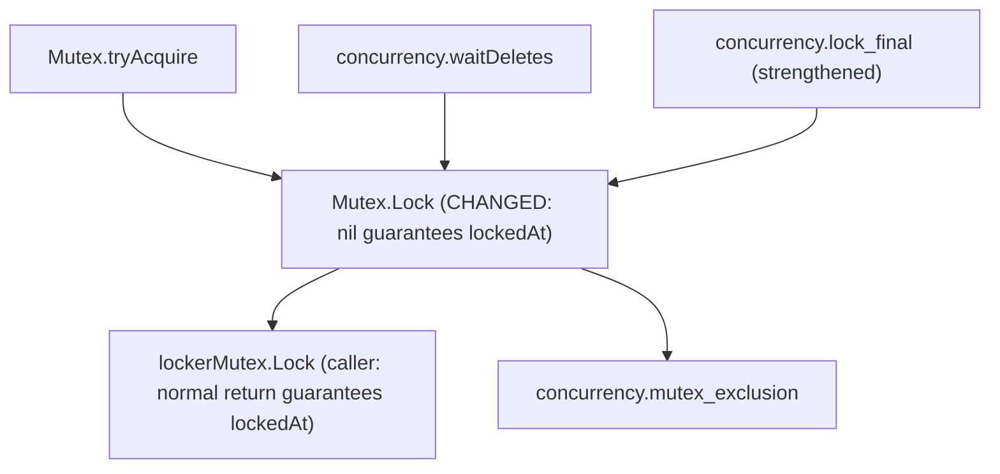

# PR verification: etcd-io/etcd#22617

- **Title**: `client/v3: fail Mutex.Lock when its key was recreated while waiting`
- **URL**: <https://github.com/etcd-io/etcd/pull/22617>
- **Author**: `upamanyus`
- **Fixes**: <https://github.com/etcd-io/etcd/issues/22613> (`issues/mutex-lock-recreated.md`)
- **PR head**: `34adb1693e4355163e0f97c6cd31b412d8e63b48`
- **Upstream base**: `22cc5d9acd4a5953dfdfc2594dbeb53da89bb0d4`
- **Goose fork branch**: `pr-etcd-22617-goose-lean` (`5860cea341762fa92eb143b7467ba59a3a6c64c9`, onto `bc9c3868ced67e518fb2fecba44ce0fa70b7303b`)
- **Proof branch**: `pr-verify/etcd-22617`
- **Tests and logs**: `notes/pr-verify/etcd-22617/` (`notes/pr-verify/etcd-22617/README.md`)
- **Verdict**: **Verified (strengthens `Mutex.Lock` and `lockerMutex.Lock` to guarantee `lockedAt` on `nil`)**

| Function | Go file | Kind | Coverage before | Coverage after | Outcome |
|---|---|---|---|---|---|
| `Mutex.Lock` | `client/v3/concurrency/mutex.go` | Behavior change | Verified (sorry-free) | Verified (sorry-free) | Strengthened spec (`Mutex__Lock.lean`): `nil` guarantees `lockedAt pfx key rev R` (drops `∨ keyRecreated pfx key rev R`, which moves to `ErrSessionExpired`) |
| `lockerMutex.Lock` | `client/v3/concurrency/mutex.go` | Caller (strengthened) | Verified (sorry-free) | Verified (sorry-free) | Strengthened spec (`lockerMutex__Lock.lean`): normal return guarantees `lockedAt pfx key rev R` |

---

## 1. What the PR Changes

In `client/v3/concurrency/mutex.go`, after `waitDeletes(ctx, client, m.pfx, m.myRev-1)` completes and `Mutex.Lock` fetches `m.myKey` via `client.Get(ctx, m.myKey)`, `etcd-io/etcd#22617` checks not only that `m.myKey` exists (`len(gresp.Kvs) != 0`), but also that its `CreateRevision` still equals `m.myRev`:

```go
	if len(gresp.Kvs) == 0 || gresp.Kvs[0].CreateRevision != m.myRev { // is the session key lost or recreated?
		return ErrSessionExpired
	}
```

Previously, if two `Mutex` instances shared a session (and therefore shared `m.myKey = fmt.Sprintf("%s%x", m.pfx, s.Lease())`), and the other `Mutex` deleted `m.myKey` (e.g. via `TryLock` returning `ErrLocked` or a canceled `Lock` calling `Unlock`) and then re-created `m.myKey` at a later create revision after a third session's key, the waiting `Mutex.Lock` saw `waitDeletes(m.myRev - 1)` finish and `len(gresp.Kvs) == 1` and returned `nil` while the third session held the lock (`issues/mutex-lock-recreated.md`).

No conflict resolution or rewrite was required when applying the PR onto `goose-lean` (`bc9c3868ced67e518fb2fecba44ce0fa70b7303b`).

---

## 2. Specification Comparison

### `Mutex.Lock` (`Spec/go_etcd_io/etcd/client/v3/concurrency/Mutex__Lock.lean`)

```lean
-- Before:
  {{ (err : GoInterface), RET #err;
      (⌜err = GoInterface.nil⌝ ∗ ∃ (key : GoString) (rev R : w64) (hdr : Loc),
        mutexState m ⟨key, rev, hdr⟩ ∗ hdrRevAt hdr R ∗ etcdReached R ∗
        (lockedAt pfx key rev R ∨ keyRecreated pfx key rev R) ∗
        ⌜pfx <+: key ∧ sint.Z lo ≤ sint.Z R⌝) ∨
      (isPkgErr ErrSessionExpired err ∗ ∃ (st' : MutexSt) (R : w64), mutexState m st' ∗
        etcdReached R ∗ etcdAbsent pfx st'.key R ∗ ⌜pfx <+: st'.key ∧ sint.Z lo ≤ sint.Z R⌝) ∨
      (⌜err ≠ GoInterface.nil⌝ ∗ ∃ st' : MutexSt, mutexState m st') }}

-- After:
  {{ (err : GoInterface), RET #err;
      (⌜err = GoInterface.nil⌝ ∗ ∃ (key : GoString) (rev R : w64) (hdr : Loc),
        mutexState m ⟨key, rev, hdr⟩ ∗ hdrRevAt hdr R ∗ etcdReached R ∗
        lockedAt pfx key rev R ∗
        ⌜pfx <+: key ∧ sint.Z lo ≤ sint.Z R⌝) ∨
      (isPkgErr ErrSessionExpired err ∗ ∃ (st' : MutexSt) (R : w64), mutexState m st' ∗
        etcdReached R ∗ (etcdAbsent pfx st'.key R ∨ keyRecreated pfx st'.key st'.rev R) ∗
        ⌜pfx <+: st'.key ∧ sint.Z lo ≤ sint.Z R⌝) ∨
      (⌜err ≠ GoInterface.nil⌝ ∗ ∃ st' : MutexSt, mutexState m st') }}
```

### `lock_final` (`Proof/go_etcd_io/etcd/client/v3/concurrency/InvMutexLemmas.lean`)

```lean
theorem lock_final (pfx key : GoString) (rev r R0 R : w64) (s0 s : List EtcdKv)
    (hrev : 0 < sint.Z rev) (h1 : sint.Z rev ≤ sint.Z r) (h2 : sint.Z r ≤ sint.Z R0)
    (h3 : sint.Z R0 ≤ sint.Z R) (hn : ∀ v ∈ s0, sint.Z (rev - W64 1) < sint.Z v.createRev)
    (v : EtcdKv) (hv : v ∈ s) (hvk : v.key = key) :
    etcdState (GF := GF) R0 pfx s0 ∗ etcdState R pfx s ⊢
      ⌜(v.createRev = rev → LockedState key rev s) ∧
       (v.createRev ≠ rev → RecreatedState key rev s)⌝
```

---

## 3. Callers and Impact



Both `Mutex.TryLock` and `Mutex.Lock` (and `lockerMutex.Lock`) now establish `lockedAt pfx key rev R` unconditionally on success (`err = nil`), so `mutex_exclusion` (`Proof/go_etcd_io/etcd/client/v3/concurrency/Results.lean:104-108`) applies directly to any successful `Lock` or `TryLock` acquisition without a side condition ruling out `keyRecreated`.

---

## 4. Trust Base (`etc/tcb-collections/pr-etcd-22617.txt`)

- **New axioms introduced**: `0`
- **New `sorry`s introduced**: `0`
- `concurrency.Mutex.Lock.wp_proof`, `concurrency.lockerMutex.Lock.wp_proof`, `concurrency.lock_final`, `concurrency.mutex_Lock`, `concurrency.locker_Lock`, `concurrency.mutex_exclusion`, and `concurrency.mutex_holder_unique` are all verified and sorry-free.

---

## 5. Findings

1. **Formal proof that `etcd-io/etcd#22617` fixes `etcd-io/etcd#22613` (`issues/mutex-lock-recreated.md`)**:
   Before this PR, `Mutex.Lock.spec` had to weaken its `nil`-return postcondition to `lockedAt pfx key rev R ∨ keyRecreated pfx key rev R` because `Lock` checked only `len(gresp.Kvs) == 0`. With `gresp.Kvs[0].CreateRevision != m.myRev` also returning `ErrSessionExpired`, `keyRecreated` moves from the `nil` branch to the `ErrSessionExpired` branch, and `Mutex.Lock` (as well as `lockerMutex.Lock`) guarantees `lockedAt pfx key rev R` on success.
   The integration test `TestMutexLockKeyRecreated` (`notes/pr-verify/etcd-22617/mutex_test.go`) fails on the base revision (`m2 locked while m3 holds the lock`, `notes/pr-verify/etcd-22617/mutex_recreated_base.log`) and passes on the PR (`notes/pr-verify/etcd-22617/mutex_recreated_head.log`).
2. **State left in `m` when returning `ErrSessionExpired` on a recreated key**:
   When `Lock` returns `ErrSessionExpired` because `gresp.Kvs[0].CreateRevision != m.myRev`, `m.myKey` and `m.myRev` retain the values written by `tryAcquire` (`⟨key, rev, st.hdr⟩`), and `Lock` does not call `Unlock` (which is essential: calling `Unlock` would delete the recreated key owned by the other `Mutex` on the same session). However, if the caller ignores `ErrSessionExpired` and later calls `m.Unlock()`, `Unlock` deletes `m.myKey` unconditionally by key name without checking `m.myRev`. This is existing behavior shared with the `len(gresp.Kvs) == 0` path.
